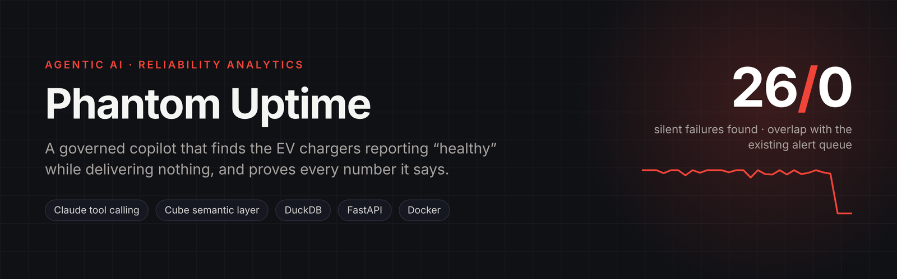
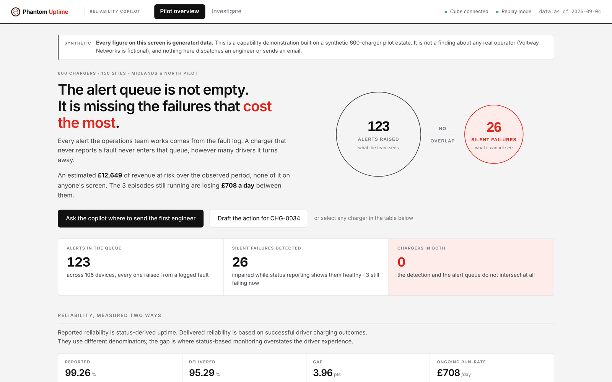
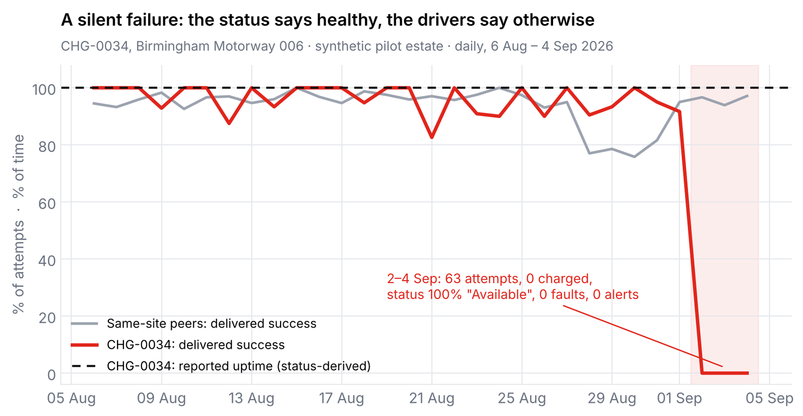
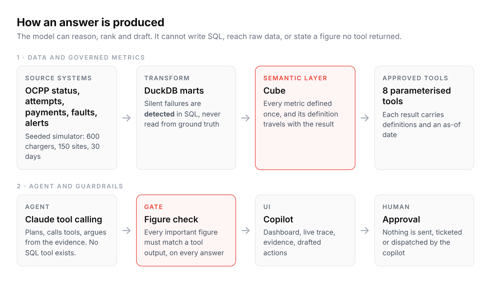
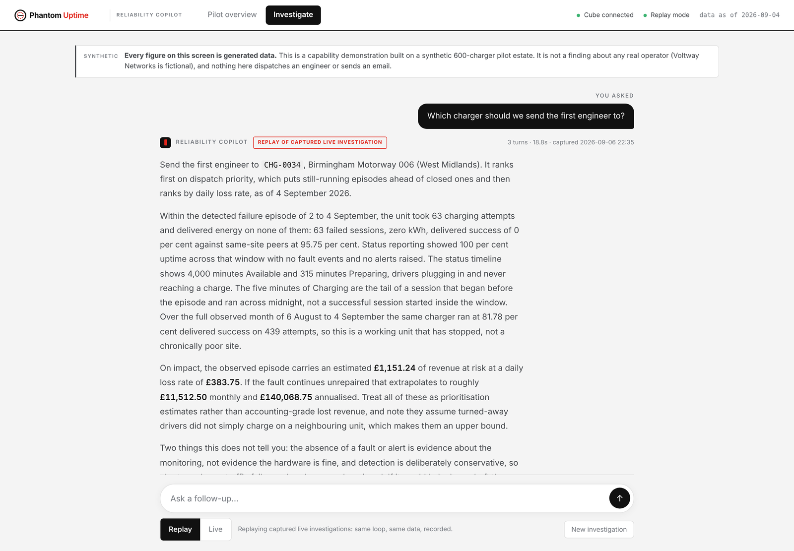
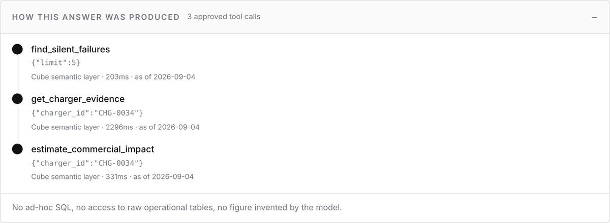
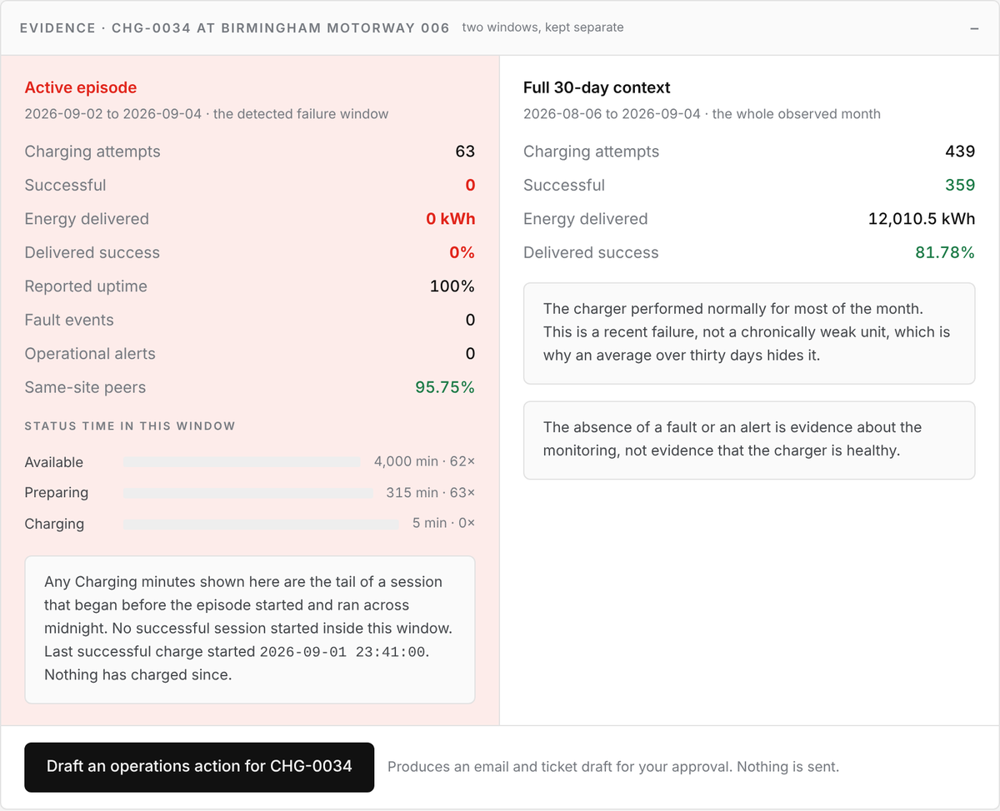
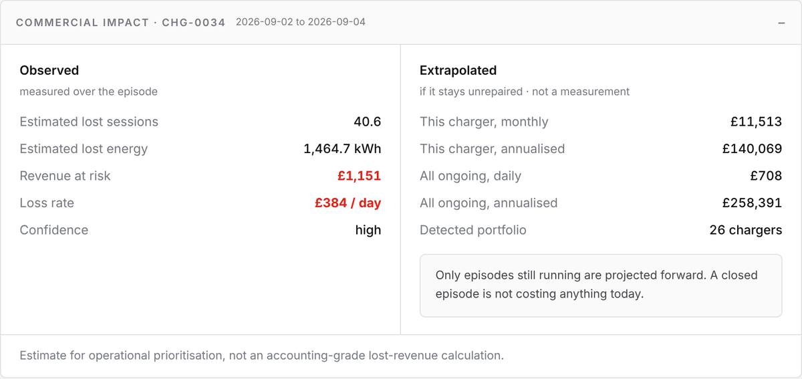
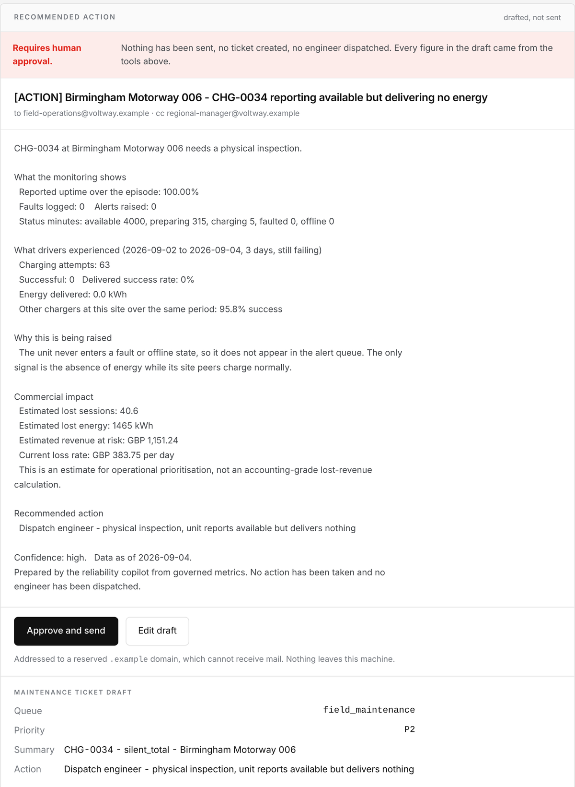

<p align="center"></p>

<p align="center">
FastAPI · Claude tool calling · Cube semantic layer · DuckDB · Docker · CI-gated answers
</p>

---

A rapid charger can look compliant to the reporting layer, healthy to the alerting
system, and dead to the driver. It walks `Available → Preparing → Available`, never
reaches `Charging`, never faults, and so never enters an alert queue built from the
fault log, however many drivers it turns away.

**Phantom Uptime** is a governed investigation workflow for that problem. Operations and
commercial users ask questions in plain English; a tool-calling agent investigates
through a small set of approved tools that read metrics defined once in a Cube semantic
layer. The model can reason, rank and draft. It cannot write SQL, reach raw data, or
state a figure that a tool did not return, and that last property is checked in code on
every answer.

> **Synthetic scenario.** Voltway Networks is a fictional operator. Every number below is
> generated by a seeded simulator; nothing here describes a real company.

<p align="center"></p>
<p align="center"><sub>The pilot overview. The alert queue and the detected silent failures share no charger, and the copilot leads with that.</sub></p>

## What it finds

On a synthetic 600-charger, 150-site pilot estate over 30 days:

| | |
|---|---|
| Reported reliability (status-derived, share of **time**) | **99.26%** |
| Delivered reliability (attempts that transferred energy) | **95.29%** |
| Existing alerts | 123 across 106 devices |
| Silent failures detected | **26** |
| Chargers in both sets | **0** |
| Hidden revenue at risk | **£12.6k**, about £708/day still leaking |

<p align="center"></p>
<p align="center"><sub>Computed from the committed raw snapshot (<code>data/raw/</code>). A charging attempt counts as delivered when it transfers more than 0.6 kWh.</sub></p>

The worked example is `CHG-0034` at *Birmingham Motorway 006*: 63 attempts in three days,
0 successful, 0 kWh, **100% reported uptime**, 0 faults, 0 alerts, while the five other
chargers on the site ran at 95.75% success. The copilot sends the first engineer there,
not because it has lost the most so far, but because it is the one still losing.

## Architecture

<p align="center"></p>

<details>
<summary>Same pipeline, with the file that implements each stage</summary>

```
 Operational source data   OCPP status events · charging attempts · payments · faults · alerts
          │                (simulate_source_systems.py, seeded, raw/)
          ▼
 OLTP → OLAP transform     DuckDB SQL builds dimensions, facts and marts   (build_marts.py)
          │                silent failures are DETECTED here, never read from ground truth
          ▼
 Cube semantic layer       governed metrics and definitions               (cube/model/)
          │
          ▼
 Approved tools            8 parameterised tools, each result carries its definitions and as_of
          │                (api/tools.py, api/tool_schemas.py)
          ▼
 Tool-calling agent        plans, calls tools, argues from the evidence   (api/agent.py)
          │
          ▼
 Figure check              every important figure must match a tool output (api/figure_check.py)
          │
          ▼
 Copilot UI                dashboard · live trace · evidence · human-approved actions (web/)
```

</details>

The approved tools: `get_reported_reliability`, `get_delivered_reliability`,
`get_gap_anatomy`, `get_alert_blindspot`, `find_silent_failures`, `get_charger_evidence`,
`estimate_commercial_impact`, `draft_ops_action`. There is no other way to reach data.

## Inside an investigation

Ask *"Which charger should we send the first engineer to?"* and the copilot answers in
prose, with every figure taken from a tool result. These screenshots are the real UI
serving a recorded live investigation in replay mode.

<p align="center"></p>

**How the answer was produced.** Three approved tool calls, each served by the Cube semantic
layer, with arguments, latency and data date. No SQL anywhere.

<p align="center"></p>

**The evidence, in two windows kept apart.** The three-day episode sits next to the full
month, so a recent failure is not averaged away, and the panel says out loud that no
alert is not the same as healthy.

<p align="center"></p>

**Commercial impact.** What was observed over the episode and what it extrapolates to are
shown separately, and both are labelled as prioritisation estimates.

<p align="center"></p>

**The drafted action.** An operations email and a maintenance ticket, addressed to a
reserved `.example` domain, waiting for a human. There is no send path in the code.

<p align="center"></p>

## Trust and governance

| Layer | Stops | Does not stop |
|---|---|---|
| No SQL, no raw access | the model reaching data nobody defined | a wrong reading of a correct number |
| Cube semantic layer | two people computing a metric two ways | the model mis-transcribing the result |
| Server-side figure check | figures no tool returned, for every caller | a wrong claim built from real figures |
| Human approval on actions | anything reaching a person or a system | anything upstream of that |
| Login, spending cap, input limits | a public URL being read or drained | a wrong answer given to someone allowed in |

* **Conservative detection.** 26 of 35 planted impairments found, no false positives
  (precision 100%, recall 74%). A noisy queue is how an operations team stops trusting a
  tool.
* **Trace validation.** Across the recorded investigations, 116 figures, none unsourced.
  The same check runs live, in replay, and in CI.
* **Nothing is sent.** The copilot drafts the operations email and the maintenance
  ticket; there is no send path in the code.

The failures found while building it, and the prompt-injection probes run against it,
are written up in [`docs/ENGINEERING_NOTES.md`](docs/ENGINEERING_NOTES.md).

## Quick start

```bash
# 1. Data: unpack the committed snapshot (or regenerate it, see DATA.md)
python scripts/unpack_data.py
pip install duckdb
python build_marts.py
python validate_marts.py              # 28 checks on the marts and the detector

# 2. Semantic layer + app
cp .env.example .env                  # ANTHROPIC_API_KEY is optional
docker compose up -d cube
pip install -r requirements.txt
uvicorn api.main:app --port 8000      # http://localhost:8000
```

Without an API key the app runs in **replay** mode and serves the eight recorded
investigations in `demo_traces/`. With a key, switch the toggle to **live** and watch the
tools fire in order.

Try asking:

* *Which chargers are missing from the alert queue?*
* *Which charger should we send the first engineer to?*
* *Why CHG-0034?*
* *Why is reported reliability different from delivered reliability?*
* *Draft an operations email for CHG-0034.*

## Repository map

| Path | What it is |
|---|---|
| `simulate_source_systems.py` | seeded generator of the operational source systems |
| `build_marts.py` | DuckDB transformation, detection and costing |
| `validate_marts.py` | 28 checks, including scoring the detector against ground truth |
| `cube/model/` | Cube semantic layer: the only place metrics are defined |
| `api/` | FastAPI app, agent loop, tools, figure check, auth and rate limits |
| `web/` | single-page copilot UI and login |
| `demo_traces/` | recorded live investigations served by replay |
| `validate_traces.py` | offline gate over the recordings |
| `data/raw/` | compressed snapshot of the generated source data |
| `DATA.md` | data model, detection logic and limitations |
| `DEPLOY.md` | single-VM deployment with Caddy, and what broke in production |
| `ONE_PAGER.html` / `.pdf` | the project on one page |

## CI

Every push runs ruff and bandit, regenerates the estate from the seed, rebuilds the marts,
runs the detector's checks, then validates the figure check and every recorded
investigation. The simulator is seeded, so CI builds byte-identical data to a laptop.

## Deliberately out of scope

No live OCPP connection, no ticketing integration, no pricing engine, and no second model
provider behind an abstraction with one implementation. The question worth prototyping
was whether an agent can produce operational judgement that survives being checked.
